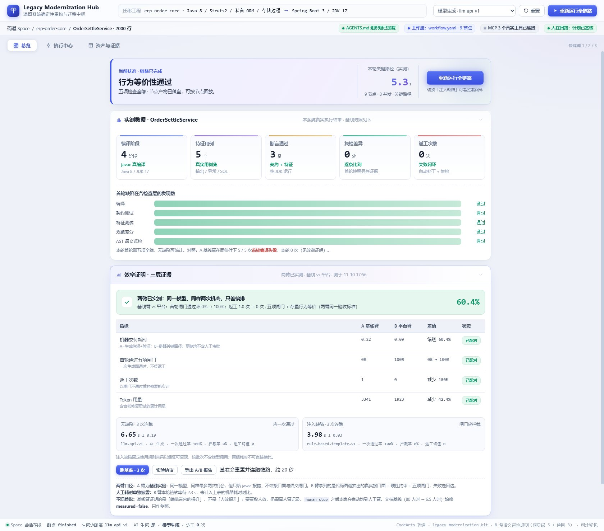
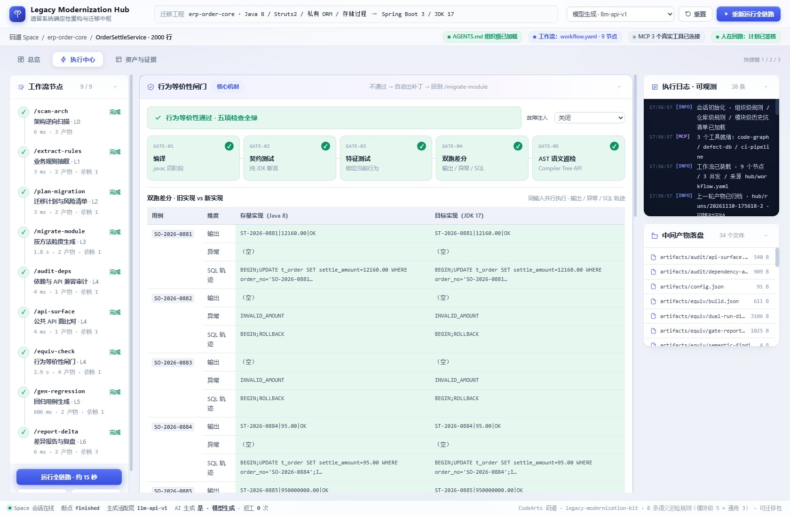
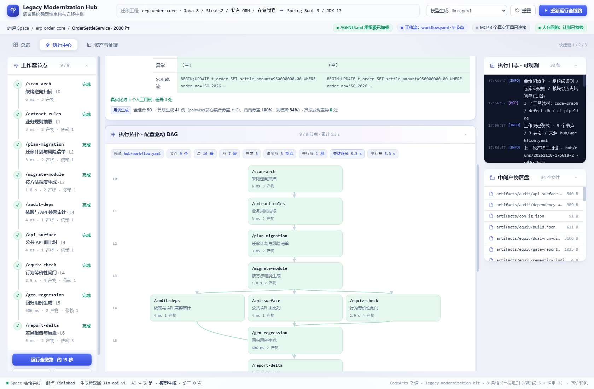

# Legacy Modernization Hub

遗留系统确定性重构与迁移中枢。真实编译、真实双跑差分、真实语义巡检、真实模型生成，
所有数字都来自本机执行产物，可逐条回放。



> 这套东西要解决的问题只有一个：**改得对不对，能不能在合入之前被机器判定。**
> 生成环节可以换（规则模板 / 模型 API），但过不过得去，只看行为是否与存量等价。

<table>
<tr>
<td width="50%"></td>
<td width="50%"></td>
</tr>
<tr>
<td align="center">五项闸门 + 双跑差分：逐用例比对输出 / 异常 / SQL 轨迹</td>
<td align="center">配置驱动的 DAG：9 节点、7 层、三路并发、关键路径 5.3 s</td>
</tr>
</table>

**快速导航**：[架构说明](docs/ARCHITECTURE.md) · [演示视频脚本](docs/VIDEO-SCRIPT.md) · [上传到 GitHub](GITHUB.md)

---

## 1. 运行环境

| 依赖 | 版本 | 用途 | 检查命令 |
|---|---|---|---|
| Node.js | 18+ | 后端服务（零依赖，无需 npm install） | `node -v` |
| JDK | 17 或 21 | 编译存量/目标代码、AST 巡检 | `java -version` |
| Python | 3.9+ | 编排引擎与实验仪器（零第三方包） | `python -V` |

三个都要在 `PATH` 里。**不需要** Maven、Gradle、npm，也不需要联网（除非要用模型生成）。

---

## 2. 启动方式

**Windows**：双击 `start.bat`
**macOS / Linux**：`./start.sh`

脚本会先做环境自检，再启动服务并自动打开 <http://127.0.0.1:8787>。

停止：`stop.bat` / `./stop.sh`（按 pid 精确停止，不会误杀其他 node 进程）。

端口冲突时换端口：

```bat
set PORT=8788 && node hub\backend\server.js
```

---

## 3. 界面上怎么用

界面分三个板块，顶部导航切换（快捷键 `1` / `2` / `3`；Tab 聚焦导航后可用
`←` `→` `Home` `End` 切换），每张卡片右上角可单独折叠：

| 板块 | 放什么 |
|---|---|
| **总览** | 当前结论、实测 KPI、首轮缺陷分布、效率证明（A/B 配对） |
| **执行中心** | 闸门五项、双跑差分、执行拓扑 DAG、迁移计划、AST 巡检、日志与产物 |
| **资产与证据** | 代码图谱 / 规则库 / 映射表、证据文件清单、MCP 工具 |

窗口宽度小于 1400px 时，右栏（日志 / 产物）会整体换行到主区下方，而不是被隐藏。

1. **运行全链路** —— 9 节点 DAG，会真实生成、编译、跑闸门，约 6–8 秒。
2. **签核通过** —— 中途会停在"迁移计划待签核"，这是设计上的强制人工决策点，不签核不会生成代码。
3. **故障注入**（右下角）—— 三档：
   - `关闭`：正常生成
   - `结构型 · 丢事务注解`：编译和单测都过，只有闸门能拦
   - `语义型 · 金额提前舍入`：人工 5 条用例全过，只有算法生成的零邻域用例能发现
4. **跑基准 · 3 次** —— 连跑取耗时分布与一次通过率。
5. **效率证明卡片** —— A 基线臂 vs B 平台臂的配对结果，含判读口径。
6. **执行拓扑卡片** —— 每个节点的耗时、尝试次数、产物数，可导出完整轨迹。

---

## 4. 项目结构

```
legacy-modernization-hub.html   前端（单文件，通过 /app.js 取数）
start.bat / start.sh            启动
stop.bat / stop.sh              停止
package.py                      打包
hub/
  workflow.yaml                 ★ 工作流定义：改这里就改编排，不用动代码
  model.example.json            模型配置样例（复制成 model.json 后填 key）
  backend/
    server.js                   Node 原生 http，零依赖
    app.js                      前端数据层
  engine/
    cli.py                      7 个 Skill 节点 + 数据集扫描
    workflow.py                 DAG 引擎（依赖/条件/审批/并发/失败回边）
    miniyaml.py                 零依赖 YAML 子集解析
    equiv.py                    五项闸门
    generator.py                生成门面（可插拔）
    generators/                 rule_based / llm / registry
    testgen.py                  用例生成（边界值 + 两两组合 + ddmin）
    efficiency.py               效率实验（A/B、基准、漏检率、协议）
    codesurface.py              从源码抽接口面喂给模型
    ast_scan/                   语义巡检器（JDK Compiler Tree API）
  sample-project/               示例工程：Java 8 存量 / JDK 17 目标 / 测试 / 规则库 / 映射表
  artifacts/                    运行产物（每次运行自动生成）
  runs/                         历史轮次归档（重置时归档，不删除）
```

---

## 5. 命令行速查

```bash
cd hub/engine

python cli.py run --restart     # 从头跑整条链路
python cli.py approve           # 计划签核，继续生成
python cli.py config --defect semantic    # 切换故障注入：off/structural/semantic
python cli.py config --adapter llm        # 切换生成适配层：rule/llm
python cli.py probe             # 看两个适配器是否可用
python cli.py dataset --path <真实项目源码目录>   # 对任意 Java 代码库跑巡检
python cli.py prune --keep 5    # 清理历史归档
```

效率实验：

```bash
python efficiency.py baseline --runs 5      # A 基线臂：同一模型，只给编译反馈
python efficiency.py bench --runs 3 --defect off   # B 平台臂基准
python efficiency.py coverage-gain --runs 5 # 手工用例漏检率
python efficiency.py ab                     # 合并成 A/B 报告
python efficiency.py protocol               # 生成实验协议
python efficiency.py human-start --label W1-A --operator 你的名字   # 真做人工实验时用
```

MCP 服务（可选，供 IDE 或 Agent 调用 11 个工具）：

```bash
python hub/mcp-server/server.py
python hub/mcp-server/smoke_test.py   # 9 项自检
```

---

## 6. 接自己的模型

1. 复制配置：
   ```bash
   cp hub/model.example.json hub/model.json
   ```
2. 填 `base_url` / `model`，然后把密钥放进环境变量（推荐）：
   ```bat
   set HUB_MODEL_API_KEY=sk-xxxx
   ```
   也可以写进 `hub/model.json` 的 `api_key` 字段（仅本机演示，`hub/model.json` 已在 `.gitignore` 里）。
3. 切换适配层：`python cli.py config --adapter llm`，或界面右上角下拉框。
4. 验证：`python cli.py probe`，应显示 `ready: true`。

没有密钥也不会崩：会自动回退规则适配器，并在 `artifacts/generation.json` 里写明 `fallback_reason`。

---

## 7. 效率是怎么证明的

三层证据，互不代言：

| 层 | 比什么 | 现在的结果 |
|---|---|---|
| A 基线臂 | 同一模型、同样最多两次机会，只回灌 javac 报错，不给接口面与闸门 | 首轮闸门通过率 **0%**，均值 2.0 次尝试 |
| B 平台臂 | 代码图谱抽出的接口面 + 硬约束 + 五项闸门 + 失败回边 | 首轮通过率 **100%**，返工 0 |
| 文档基线 | 80 人时 → 6.5 人时 | **不参与计算**，只作参照，界面标 `measured=false` |

配对结果（本机实测，每次运行会有波动，以 `artifacts/w1/ab-report.json` 为准）：

| 指标 | A 基线臂 | B 平台臂 | 差值 |
|---|---|---|---|
| 机器交付耗时 | 0.22 min | 0.10 min | −53.4% |
| 首轮通过五项闸门 | 0% | 100% | — |
| 返工次数 | 1 | 0 | −100% |
| Token 用量 | 3341 | 1923 | −42.4% |

**注意口径**：基线臂证明的是"编排带来的提升"，不是"人效提升"。
要宣称人效，必须用 `human-start` 记录真人实验，`human-stop` 之后界面会自动切到人工臂。

判读规则写在 `artifacts/w1/protocol.md`，其中明确：任一臂缺测就只报"待实测"，不计算差值。

---

## 8. 数据真实性

- **示例工程是构造的**：`hub/sample-project` 是为复现"编译通过但行为被静默破坏"而写的 1 个模块（约 200 行），
  业务规则与映射表是手写的。它来自真实业务的模式，但**不是**某家公司真实代码。
- **算法与闸门是真的**：真 javac、真差分、真 AST 解析、真模型调用。
- **真实代码库上的扫描**：`python cli.py dataset --preset commons-lang`（随包数据集）
  或 `--path <目录>`（任意 Java 项目）都能跑通用巡检。
  已对 Apache Commons Lang（commit 5d2715b）跑过：264 个文件 / 397 个类 / 4579 个方法，
  产出 42 条真实迁移风险（`java.util.Date` 20 处、空 catch 17 处、`SimpleDateFormat` 5 处），耗时 602 ms。
  报告在 `artifacts/dataset/scan-report.json`。
- **模型生成的是真的**：模型是 DeepSeek，Token 与耗时来自真实响应，价格按官方价目表折算。

### 一个具体的例子（可复现）

把「故障注入」切到 **语义型 · 金额提前舍入**，跑一次链路，会看到：

1. 编译通过、契约测试通过、人工 5 条用例 **0 处差异**；
2. 算法生成的 41 条用例（90 种全组合裁剪而来，两两覆盖 100%）发现 **24 处差异**——
   金额 0.001 / 0.004 时存量返回 `0.00`，被测实现抛 `INVALID_AMOUNT`；
3. 平台把这 24 条失败用例回灌给模型，重生成后复检 **0 差异**。

这就是"用例生成"这一层算法存在的意义：人工挑的用例覆盖的是想得到的场景，缺陷长在没想到的边界上。

所以对外表述建议：*编排与闸门在真实代码上验证过；迁移 A/B 在构造的复现模块上测得。*

---

## 9. 打包分发

```bash
python package.py                   # 完整包：含真实数据集（约 0.9 MB）
python package.py --slim            # 瘦包：不含数据集（约 130 KB）
python package.py --with-artifacts  # 连当前运行产物一起打
python package.py --with-key        # 把密钥一起打进去（只限本机演示，不要外发）
```

产物在 `dist/legacy-modernization-hub-<日期>.zip`。
接收方解压后双击 `start.bat`（mac/linux 用 `./start.sh`）即可，无需安装任何 Python/Node 依赖。

| | 完整包 | 瘦包 |
|---|---|---|
| zip 体积 | 0.9 MB | 0.13 MB |
| 文件数 | 321 | 52 |
| 解压后 | 4.5 MB | 380 KB |
| 含真实数据集 | ✅ 264 个 Java 源文件 | ❌ |

包为什么不大：零第三方依赖（不带 `node_modules`）、界面纯 CSS+SVG 无图片字体、
Java class 首次运行自动编译、运行产物可重跑不入包。
多的 4 MB 全是 Apache Commons Lang 的真实源码。

包里有一份 `MANIFEST.txt`，写明文件数、解压/压缩字节、按目录构成、数据集来源与提交版本、
以及刻意不含的东西，可以直接拿去核对。

---

## 10. 常见问题

**Q：双击 start.bat 一闪而过？**
在 cmd 里手动运行 `start.bat`，脚本会停在报错处。多半是 Node/Java/Python 没进 PATH。

**Q：页面打开是空白 / 提示后端未连接？**
服务没起来。看 `hub/artifacts/server.out`（Linux）或启动窗口里的报错；端口被占用就换 `PORT`。

**Q：闸门一直 FAIL · SCAN-ERR？**
语义巡检器没编译。`python hub/engine/cli.py run` 会自动自举编译；也可手动
`javac -encoding UTF-8 -d hub/engine/ast_scan/build hub/engine/ast_scan/*.java`。

**Q：模型调用很慢或超时？**
`hub/model.json` 里把 `timeout` 调大（默认 90 秒）；网络不通会回退规则适配器，链路不会断。

**Q：想换一个被迁移的模块？**
改 `hub/workflow.yaml` 的节点、`hub/sample-project` 下的源码与规则库即可，引擎不用动。

---

## 11. 目录里还有什么

| 文件 | 内容 |
|---|---|
| [`docs/ARCHITECTURE.md`](docs/ARCHITECTURE.md) | 分层结构、五个关键设计、一次运行的完整数据流 |
| [`docs/VIDEO-SCRIPT.md`](docs/VIDEO-SCRIPT.md) | 3 分 40 秒演示脚本：每个镜头点哪个按钮、说什么 |
| [`GITHUB.md`](GITHUB.md) | 推送到 GitHub 的三步操作与注意事项 |
| `screenshots/` | README 用的界面截图 |
| `.github/workflows/ci.yml` | CI：语法检查、巡检器编译、MCP 自检（无需密钥） |

## 12. 许可证

Apache License 2.0，见 [LICENSE](LICENSE)。
内置的 Apache Commons Lang 数据集同样为 Apache-2.0，其许可证与来源记录在
`dataset/commons-lang/` 下（仅在完整分发包中提供）。
